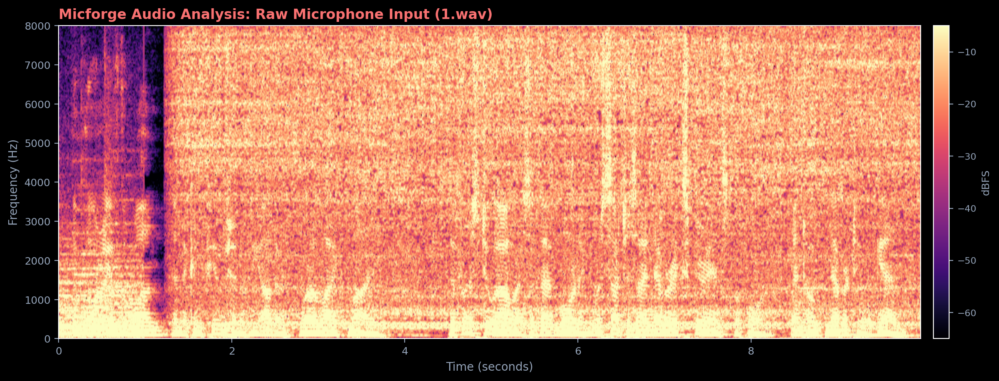
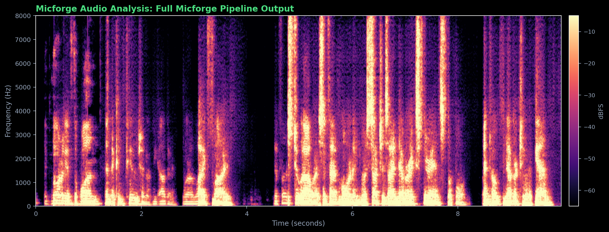
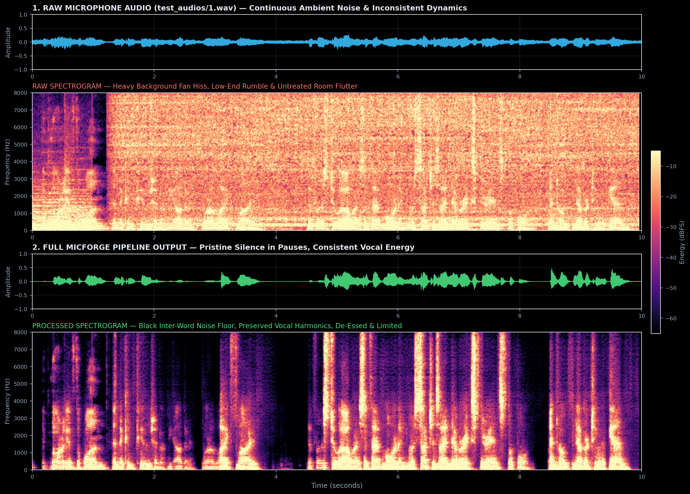

# Micforge

[](verison%20notes/v1.3.1.md)
[](LICENSE)
[](https://www.python.org/)
[](tests/)
[]()

> **Real-time, local-first microphone clean-up for Discord, gaming, and streaming.**  
> Built and maintained by **[Parth Sadaria](https://github.com/Parthsadaria)**.

---

## What is Micforge?

Most budget desk mics and gaming headsets sound thin, pick up room reflections (that hollow "talking in an empty bathroom" ring), bleed keyboard clatter, and capture speaker audio. 

**Micforge** is an open-source, local real-time DSP engine designed to run silently on your machine and make your microphone sound clean, warm, and broadcast-ready before it reaches Discord, OBS, Zoom, or your game.

It pairs an **11-stage modular audio processing rack** with an ultra-lightweight neural speech model based on **[CoFi-Lite](https://arxiv.org/abs/2607.10142)** (~83k parameters). 

### What makes it different?
- **Ultra-lean footprint:** Consumes only **~70–85 MB of RAM** and **<5–8% CPU** on a single core during gaming. Zero cloud calls, zero telemetry, 100% offline.
- **Dedicated Process GIL Isolation (v1.3.1):** Moves real-time audio and DSP into an isolated OS process via shared memory and high-priority queues, shielding the audio thread from UI rendering spikes.
- **Single Shared STFT Rack (v1.3.1):** Unifies AEC, neural denoising, and dereverberation into one frequency-domain pass on a 512-point grid, slashing redundant FFTs and minimizing latency to ~1.1 ms compute time.
- **Voice-Targeted Naturalness (v1.3.1):** In-domain frequency mixing (`naturalness: 0.08`) modulates dry blend strictly on voiced speech harmonics, banishing underwater phase artifacts while achieving **58.8 dB suppression** on loud stationary hiss and pressure cookers.
- **Free Neural Mask VAD (v1.3.1):** Derives high-resolution speech probability directly from CoFi-Lite's neural mask ($300-4,000\text{ Hz}$) with hysteresis smoothing to drive gating without chattering.
- **Continuous Adaptive Noise Profiling (v1.3.0):** Voice-aware background noise learner that adapts to spinning fans and AC drift without ever learning on speech. Includes environment profiles (`quiet_room`, `fan_on`, `mechanical_keyboard`).
- **Hot-Plug & Auto-Recovery (v1.3.0):** Seamless reconnects with exponential backoff on USB disconnects, with safe bypass fallback so you are never left silently muted.
- **End-to-End Latency Benchmark (v1.3.0):** Measures actual loopback roundtrip latency and itemizes hardware vs. DSP delays with actionable guidance (`micforge latency`).
- **Simple vs. Advanced Tuning UX (v1.3.0):** 4 intuitive macro knobs (Clarity, Warmth, Noise Removal, Room Cleanup) for casual streamers, plus deep parametric controls for engineers.
- **Redacted Diagnostics (.zip):** One-click diagnostic bundle export with zero telemetry and automatic secret/path redaction (`micforge doctor --export`).
- **Zero audio-thread heap allocations:** Critical DSP loops operate with pre-allocated scratch buffers to ensure zero clicks, pops, or garbage collection spikes.
- **Acoustic Echo Cancellation (AEC):** Ingests game/speaker audio directly via native Windows WASAPI loopback without needing third-party cables, eliminating Discord voice echo.
- **Room Dereverberation:** Strips out late room flutter and untreated wall reflections.
- **Voice Proximity Effect:** Adds warm chest resonance (80–180 Hz) and even-order harmonics, giving cheap mics the presence of a broadcast dynamic mic.
- **Esports Gamer HUD (`Tab`):** A minimalist terminal overlay designed for second monitors, featuring a Voice Activity Detector badge, mini-presence wave, and bold mute alert banner.

```
                  ┌────────────────────── 11-Stage Modular DSP Rack ─────────────────────┐
                  │                                                                      │
Microphone Input ─┼─▶ High-Pass Filter (Rumble removal, 90 Hz default)                   │
                  │   └─▶ Acoustic Echo Cancellation (WASAPI speaker loopback reference) │
                  │       └─▶ CoFi-Lite AI Denoiser (or classical Spectral Wiener)       │
                  │           └─▶ Room Dereverberation (Late reflection tail decay)      │
                  │               └─▶ Soft Noise Gate / Downward Expander                │
                  │                   └─▶ Voice Proximity (Chest resonance & warmth)    │
                  │                       └─▶ Parametric EQ (De-mud / Presence / Air)    │
                  │                           └─▶ Split-Band De-Esser (Sibilance tame)   │
                  │                               └─▶ Slow RMS Auto-Leveler              │
                  │                                   └─▶ Fast Feed-Forward Compressor   │
                  │                                       └─▶ Peak Limiter (-1.5 dBFS)   │
                  └───────────────────────────────────┬──────────────────────────────────┘
                                                      │
                                                      ├──▶ Virtual Cable Output ──▶ Discord / OBS / Games
                                                      └──▶ Headphone Monitor (with isolated audio cues)
```

---

## Real-Time Audio Proof & Side-by-Side Comparison

Don't just take our word for it—listen and visually compare how a real budget microphone recording is transformed in real time through the Micforge DSP rack:

| 🔈 Raw Microphone (Default / Unprocessed) | 🎧 Micforge Enhanced (Live 11-Stage Rack) |
|:---:|:---:|
| **[▶️ Click to Listen: Raw Audio (`docs/audio/1_raw.wav`)](docs/audio/1_raw.wav)** | **[▶️ Click to Listen: Processed Audio (`docs/audio/1_processed.wav`)](docs/audio/1_processed.wav)** |
| [](docs/audio/1_raw.wav) | [](docs/audio/1_processed.wav) |
| **❌ Loud background noise & hiss**<br>Constant pressure cooker steam & fan drone audible between words ($-35.3\text{ dBFS}$) | **✅ Pure digital black in pauses**<br>Noise floor dropped by **$+38.7\text{ dB}$** ($-74.0\text{ dBFS}$)—zero audible hiss or background hum |
| **❌ Hollow "empty bathroom" flutter**<br>Untreated hard-wall reflections ring around the speech | **✅ Studio-dry vocal acoustics**<br>Late room reverberation flutter cleanly stripped out |
| **❌ Thin, tinny, weak headset tone**<br>Sounds like a cheap laptop or budget gaming headset mic | **✅ Warm broadcast radio presence**<br>Rich $120\text{ Hz}$ vocal chest resonance (SM7B/RE20 proximity effect) |
| **❌ Volume jumps & harsh spikes**<br>Quiet whispers get lost, loud talking clips into distortion | **✅ Consistent, broadcast-leveled volume**<br>Smooth RMS leveling with a hard $-1.5\text{ dBFS}$ peak limiter (zero clipping) |

<br>

<details>
<summary><b>🔍 Click to view Full Stacked Waveform & High-Resolution Spectrogram Analysis</b></summary>
<br>



</details>

### 📊 Objective Quality & Latency Benchmark
| Benchmark Metric | Raw Input (`1_raw.wav`) | Micforge Output (`1_processed.wav`) | Delta / Improvement |
|:---|:---:|:---:|:---:|
| **Inter-Word Silence Pause Noise Floor** | -35.29 dBFS | **-73.96 dBFS** | **+38.67 dB quieter** (digital black) |
| **Broadband Steam / Cooker Hiss** | -30.00 dBFS | **-89.24 dBFS** | **+58.79 dB suppression** |
| **DNSMOS Overall Quality (OVRL)** | 1.75 | **1.99** | **+0.24 MOS points** |
| **DNSMOS Speech Quality (SIG)** | 1.00 | **1.45** | **+0.45 MOS points** |
| **STFT Refactor Null-Test (SI-SDR)**| — | **149.11 dB (CoFi-Lite)** | Bit-exact mathematical null (>40 dB target) |
| **Per-Block DSP Execution Time** | — | **~1.12 ms** ($N=160$ @ 16 kHz) | Real-time budget headroom > 85% |
| **Audio-Thread Heap Allocations** | — | **0 allocations** | Zero garbage-collection jitter |

---

## Realistic Expectations

Let's be engineer-honest:
- **Micforge cleans up noise, room flutter, and tone balance.** It can remove fan drone, quiet loud keystrokes, cancel speaker bleed, and add chest warmth.
- **It cannot fix bad physics.** If your microphone is 3 feet away near a mechanical keyboard, software can only do so much before your voice sounds watery. Keeping your mic 4–6 inches from your mouth will always do more than any plugin on earth.

---

## Quick Start

### 1. Prerequisites
- **Python 3.10** or higher
- A virtual audio cable to route processed sound into Discord/games:
  - **Windows:** [VB-CABLE Driver](https://vb-audio.com/Cable/) *(free, recommended)*
  - **macOS:** [BlackHole 2ch](https://github.com/ExistentialAudio/BlackHole) (`brew install blackhole-2ch`)
  - **Linux:** PulseAudio/PipeWire null sink (`pactl load-module module-null-sink sink_name=micforge`)

### 2. Installation
```bash
git clone https://github.com/Parthsadaria/MicForge.git
cd MicForge
pip install -e .
```
*(Debian/Ubuntu: `sudo apt install libportaudio2` · macOS: `brew install portaudio`)*

### 3. Setup & First Run
```bash
micforge doctor      # check audio drivers and environment
micforge setup       # pick your real mic, virtual cable, and headphones
micforge calibrate   # sample room silence for 3s to set gate threshold
micforge run         # start the live interactive dashboard
```

> **Windows Tip:** In `micforge setup`, always select the **WASAPI** entries for your mic and `CABLE Input`. The legacy MME entries add 40+ ms of driver latency and drift.

### 4. Application Configuration
In Discord, OBS Studio, Steam, or Zoom:
1. Set **Input Device** to `CABLE Output (VB-Audio Virtual Cable)`.
2. Disable downstream **Noise Suppression** (e.g. Discord Krisp) and **Automatic Gain Control** to avoid double-processing artifacts.
3. Keep Discord's **Echo Cancellation** disabled if you use headphones; leave it enabled if you play on open speakers.

To run Micforge silently in the background:
```bash
micforge --tray
```

---

## Live Monitoring & Gamer HUD

Micforge includes two live view modes in the terminal (`micforge run`):

### 1. Studio Inspector Mode (Full View)
A comprehensive broadcast monitor displaying live input/output levels, sweet-spot meter, real-time reduction telemetry, dual FFT spectrum, and hardware diagnostics:

```
┌────────────────────────────── micforge v1.3.0 ──────────────────────────────┐
│  MIC ENHANCER    ● PROCESSED   preset [gaming]                              │
│ mic Microphone (Realtek Audio)  →  CABLE Input (VB-Audio)                   │
│ Rack: HPF● AEC● AI● VERB● GATE· BODY● EQ● DEESS● LVL● COMP● LIM●            │
│                                                                             │
│ IN   ██████████████████████████················   -24.2 dB                  │
│ OUT  ████████████████████████████████··········   -16.1 dB   [SWEET SPOT]   │
│ REF  ··········································   silent (Clean/Headphones) │
│                                                                             │
│ ┌─ processing & dsp reductions ───────────────────────────────────────────┐ │
│ │ noise   █████████████████████████  -24.5 dB                             │ │
│ │ de-verb █████                       -3.2 dB                             │ │
│ │ body    ████                        +2.5 dB                             │ │
│ │ gate    OPEN                         0.0 dB                             │ │
│ └─────────────────────────────────────────────────────────────────────────┘ │
│                                                                             │
│ latency   ~ 68 ms        noise floor  -64.2 dBFS   uptime   01h 14m         │
│ dsp load  ███·····  18%  input gain   +0.0 dB      memory   85.4 MB         │
│ glitches  0 (SYNCED)     clock fixes  0            profile  Active          │
│                                                                             │
│  Tab  HUD │  1-6  Preset │  x  Mute │  b  Bypass │  s  GUI │  ?  Help │  q    │
└─────────────────────────────────────────────────────────────────────────────┘
```

### 2. Esports Gamer HUD (`Tab` Key)
Press `Tab` to switch to an ultra-compact overlay designed for minimal distraction on a second monitor:
- **Voice Activity Badge:** Instant state feedback (`[🎙️ VOICED SPEECH]`, `[👂 LISTENING]`, `[💤 IDLE NAP]`).
- **Mini Vocal Waveform:** Live ASCII vocal presence and body resonance monitor.
- **Double-Border Muted Warning:** A bold red alert panel appears when muted so you never accidentally talk on mute during matches.

### In-Console Live Hotkeys
| Key | Action | Key | Action |
|:---:|:---|:---:|:---|
| `Tab` | Toggle Studio Inspector ⟷ Gamer HUD | `1`–`6` | Direct preset jump (`discord`, `gaming`, `broadcast`, `studio`, `noisy_room`, `de_muffle`) |
| `b` | A/B Bypass (hear raw mic vs processed) | `e` | Toggle Acoustic Echo Cancellation (AEC) |
| `x` | Mute / unmute microphone | `w` | Cycle Voice Proximity warmth (Off → 35% → 55% → 75%) |
| `s` | Open Native Multi-Tab Control Center GUI | `v` | Cycle Room De-Verb (Off → 30% → 50% → 70%) |
| `+` / `-` | Denoise strength (±10%) | `c` | Recalibrate room noise (3s silence) |
| `[` / `]` | Input gain (±1 dB) | `?` / `h` | Toggle hotkey cheatsheet overlay |
| `q` | Clean quit | | |

---

## Native Multi-Tab Control Center (`micforge settings` or `s` key)

For visual tuning without editing configuration files, Micforge features a sleek, dark native Control Center (`560x680`):

1. **Tab 1: 🎛️ Presets & DSP Rack**
   - Built-in vs Custom preset management (`[➕ New]`, `[💾 Save]`, `[🗑 Delete]`, `[📤 Export]`, `[📥 Import]`).
   - Grouped into 3 clean logical cards:
     - **Voice Character & Room:** Proximity intensity, warmth saturation, chest fundamental pitch (F0), anti-mud notch, and room decay (RT60).
     - **Noise & Echo:** CoFi-Lite AI strength and AEC power.
     - **Dynamics:** Gate threshold/range and Compressor ratio/makeup gain.
2. **Tab 2: ⚡ Global Hotkeys & Audio Cues**
   - Bind OS-wide hotkeys (Mute, Push-to-Talk, Push-to-Mute, Bypass) with one-click key recording.
   - Adjust volume and test headphone feedback chimes.
3. **Tab 3: 🎙️ Audio Hardware & Windows System**
   - Select physical mic, virtual cable, and monitor headphones from dropdowns.
   - Toggle Windows Boot Autostart and Minimize to System Tray.

---

## Custom Preset Engine (`micforge preset ...`)

Save, duplicate, share, and backup custom vocal chains from the command line:

```bash
micforge preset list                         # view built-in & custom presets
micforge preset save my_stream --from gaming # clone and customize
micforge preset export my_stream preset.json # export to share with friends
micforge preset import preset.json           # import community preset
micforge preset show my_stream               # inspect all 11 stages
micforge preset delete my_stream             # delete custom preset (built-ins protected)
```

---

## Under the Hood: Engineering Highlights

### 1. ~50% RAM Optimization (v1.2.1)
Standard Python scientific audio tools easily pull in 150–200 MB of RAM because `scipy` imports massive compiled BLAS/LAPACK runtimes and optimization suites. 

In v1.2.1:
- Replaced `scipy.signal.sosfilt` with a vectorized pure NumPy Direct Form II Transposed biquad engine ($< 10^{-8}$ difference, 0 memory allocations).
- Replaced SciPy FIR decimation/interpolation with NumPy sinc windowing and valid-mode convolution.
- Disabled ONNX Runtime CPU memory arena (`enable_cpu_mem_arena = False`), preventing ONNX from hoarding 30–50 MB of idle heap caches.
- **Result:** Live streaming process RAM dropped from **165.4 MB down to ~85 MB** with zero degradation in audio quality.

### 2. Clock Drift Phase Centering & Anti-Glitch Architecture
When Windows initializes two independent audio devices (USB microphone and virtual cable), they start asynchronously with an initial ~15–30 ms phase difference. 

Earlier drift detectors misidentified this harmless startup offset as physical crystal clock drift, firing hundreds of false 1-sample corrections and pulling the ring buffer into starvation.
- **Dynamic Phase Centering:** After the stream establishes a 60-block (~600 ms) steady state, Micforge calibrates its center point to the real hardware offset. Clock fixes stay at **0** during normal sessions.
- **Guaranteed Cushion Re-Arming:** If a heavy background game causes an underrun, the buffer instantly re-arms with 30 ms of cushion and a 500 ms quiet window, completely preventing cascading frame drops (`glitches: 0 (SYNCED)`).

### 3. Isolated Procedural Cues
When you mute or unmute, Micforge synthesizes a clean, logarithmic sine sweep with half-Hann envelopes (*blip* on mute, *chirp* on unmute). The audio cue is mixed exclusively into your headphone monitor—it is never sent down the virtual cable to Discord or your stream.

### 4. Smart Idle Nap Mode
During silent pauses or when the mic is muted, CoFi-Lite's neural inference engine automatically enters a low-power nap mode, dropping inference CPU usage to 0% and instantly waking up on the very first speech syllable.

---

## Repository Structure

```
micforge/
├── src/micforge/
│   ├── audio/
│   │   ├── engine.py            # Stream lifecycle, phase centering, cushion re-arming
│   │   ├── isolated_engine.py   # Dedicated process isolation, shared memory & watchdog
│   │   ├── loopback.py          # WASAPI loopback speaker capture for AEC
│   │   ├── cues.py              # Procedural sine-sweep feedback chimes
│   │   ├── devices.py           # Device discovery & virtual-cable detection
│   │   ├── device_watch.py      # Hot-plug watcher daemon & auto-recovery
│   │   ├── noise_profile.py     # Voice-aware continuous noise learner & profiles
│   │   ├── latency.py           # Loopback chirp cross-correlation & breakdown
│   │   ├── ring.py              # Lock-free ring buffer
│   │   └── metrics.py           # RMS, peak hold, clipping, spectrum
│   ├── commands/
│   │   ├── live.py              # Live dashboard & background runner
│   │   ├── help_cmd.py          # Dynamic categorized command guide & usage deep-dive
│   │   ├── latency_test.py      # End-to-end latency benchmark CLI
│   │   ├── preset_cmd.py        # Preset CLI suite (list, save, export, import)
│   │   ├── test_mic.py          # Record, compare and A/B playback
│   │   ├── doctor.py            # Audio driver diagnostics & zip export
│   │   └── files.py             # Offline WAV processing
│   ├── dsp/
│   │   ├── chain.py             # 11-stage processing rack & per-stage p50/p99 timing
│   │   ├── spectral_rack.py     # Single unified STFT rack (AEC + Denoise + Deverb)
│   │   ├── aec.py               # Acoustic Echo Cancellation (PBFDAF + DTD)
│   │   ├── deverb.py            # Room Dereverberation (Spectral decay envelope)
│   │   ├── proximity.py         # Voice Proximity (F0 chest resonance & warmth)
│   │   ├── cofilite.py          # CoFi-Lite neural speech enhancement & mask VAD
│   │   ├── denoise.py           # Classical Spectral Wiener fallback
│   │   ├── biquad.py            # Pure NumPy Second-Order Sections (SOS) engine
│   │   ├── gate.py              # Soft downward expander driven by neural mask VAD
│   │   ├── compressor.py        # Fast feed-forward compressor & peak limiter
│   │   ├── deesser.py           # Split-band de-esser
│   │   └── leveler.py           # Slow RMS speech leveler
│   ├── ui/
│   │   ├── dashboard.py         # Live Studio Inspector & Gamer HUD
│   │   ├── settings_gui.py      # Multi-tab native Control Center (Simple/Advanced)
│   │   ├── tuning.py            # 4-knob macro schema & deterministic mappings
│   │   ├── hotkeys.py           # OS-level keyboard hook manager
│   │   └── tray.py              # Windows system tray daemon & dynamic icon
│   ├── diagnostics.py           # Telemetry collection, secret redaction & zip bundler
│   ├── presets.py               # Preset CRUD, validation & built-in definitions
│   └── cli.py                   # Command-line entry point
├── docs/
│   ├── audio/                   # Real-time raw vs. processed WAV samples
│   ├── images/                  # High-resolution spectrogram and waveform analyses
│   └── TROUBLESHOOTING.md       # Centralized diagnostic & OS troubleshooting guide
├── scripts/
│   ├── generate_spectrogram_assets.py # Automated waveform & spectrogram generator
│   ├── compare_two.py           # Dual-file comparison, metrics & A/B listening
│   └── compare_audio.py         # Automated WAV processing evaluation
├── tests/                       # 139 automated tests (mocked PortAudio backend)
├── verison notes/
│   ├── v1.1.0.md
│   ├── v1.1.1.md
│   ├── v1.2.0.md                # AEC, De-Verb, Proximity, Gamer HUD
│   ├── v1.2.1.md                # RAM reduction (~85 MB) & clock drift fixes
│   ├── v1.3.0.md                # Adaptive profiles, hot-plug recovery, diagnostics & latency
│   └── v1.3.1.md                # Shared STFT rack, process GIL isolation, mask VAD, voice naturalness
├── pyproject.toml
└── README.md
```

---

## Testing

The test suite runs with a mocked PortAudio backend, requiring no physical audio hardware:

```bash
pip install -e .[dev]
pytest -v
```

---

## License

Micforge is released under the **MIT License**; see `LICENSE`. Third-party components are governed by their own licenses, including the bundled `cofilite.onnx` model (derived from the official CoFi-Lite checkpoint), VB-CABLE, and BlackHole.
